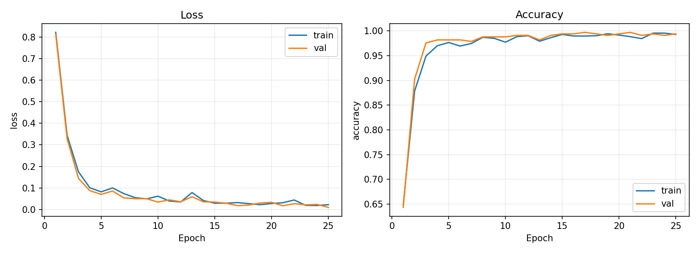
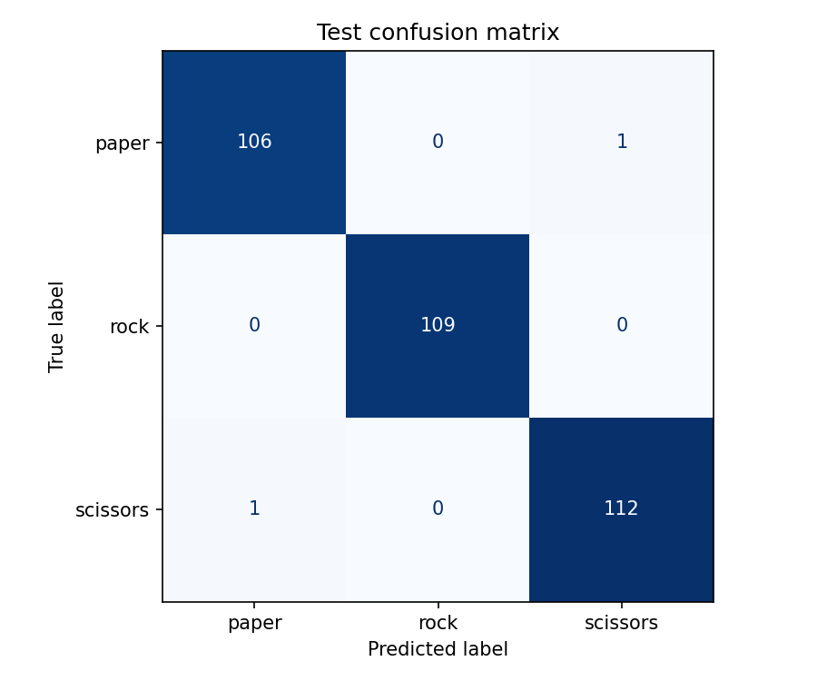
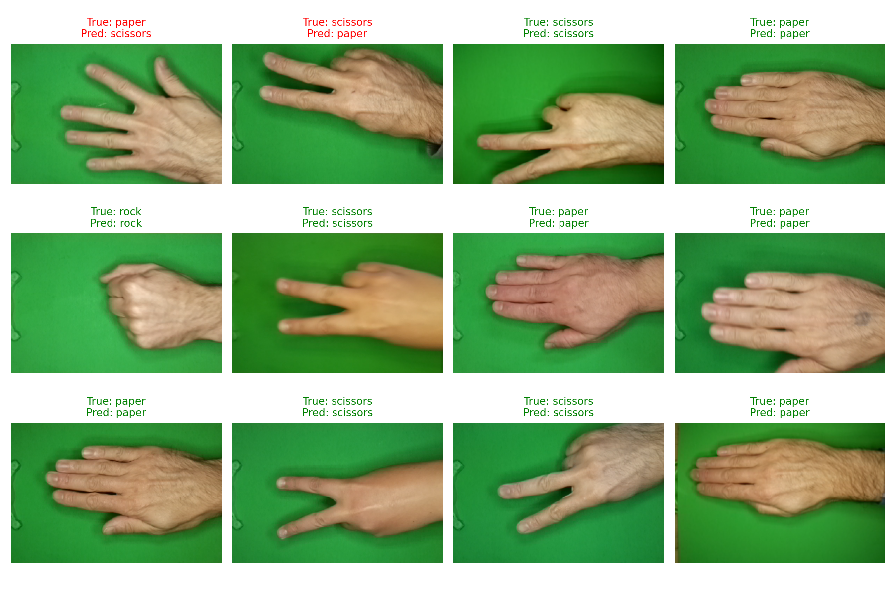

# ЛР3. Классификация жестов «камень, ножницы, бумага»

Простая система классификации изображений на основе собственной свёрточной нейронной сети.
Реализация: Python, PyTorch и torchvision. Обучение с нуля на CPU.

## Быстрый запуск на Arch Linux

Из каталога `lab3` (корень проекта):

```bash
python -m venv .venv
source .venv/bin/activate
python -m pip install --upgrade pip
python -m pip install torch torchvision --index-url https://download.pytorch.org/whl/cpu
python -m pip install -r requirements.txt
# Если папки paper, rock и scissors ещё не скачаны:
python src/download_data.py
```

Изображения находятся непосредственно в папках `paper/`, `rock/` и `scissors/`
в корне проекта. Повторно скачивать данные не нужно. Скрипты используют корень
проекта как каталог изображений по умолчанию; ссылка `data/raw` не требуется.

Если архив уже скачан с Kaggle, вместо последней команды:

```bash
python src/download_data.py --zip ~/Downloads/archive.zip
```

В проект включены обученные веса, готовое разбиение и результаты.
Проверка включённой модели на том же test:

```bash
python src/evaluate.py
python src/predict.py paper/mUqkjFi6NBsHR7tf.png
```

Чтобы самостоятельно повторить обучение, сохранённое разбиение можно использовать напрямую:

```bash
python src/train.py --epochs 25 --batch-size 32 --threads 4 --out results_new
python src/evaluate.py --run results_new
```

Для создания разбиения заново с тем же seed:

```bash
python src/prepare_data.py --data . --out data --seed 42
```

Не меняйте разбиение между обучением и тестированием. `src/evaluate.py` проверяет хеш манифеста.
`src/train.py` не перезаписывает существующий checkpoint: для нового запуска нужна другая папка `--out`.

Используйте Python, для которого доступны совместимые сборки torch/torchvision.
Проверенная среда этого запуска — Python 3.12.14; версии библиотек сохранены в
[environment.txt](results/environment.txt). Если после обновления Arch для системного Python
ещё нет колёс PyTorch, создайте venv на Python 3.12. Виртуальная машина не требуется.

Все исходники находятся в `src/`, разбиение и сводка датасета — в `data/`,
изображения — в папках классов в корне, результаты — в `results/`.
Пути по умолчанию вычисляются относительно корня проекта, поэтому скрипты можно
запускать из любого каталога. Явно заданные относительные пути (например, `--out`
или путь к изображению) отсчитываются от текущего рабочего каталога.

Чтобы пересоздать README из сохранённых результатов:

```bash
python src/make_report.py
```

## 1. Теоретическая база

Классификация с учителем сопоставляет изображению одну из заранее известных меток.
В этой работе классы — `paper` (бумага), `rock` (камень), `scissors` (ножницы).

Свёрточный слой применяет обучаемые фильтры к локальным областям изображения. Общие веса
фильтра используются по всей картинке. Начальные слои могут выделять границы и текстуры,
последующие — их комбинации, полезные для распознавания формы руки.
ReLU вычисляет `max(0, x)` и добавляет нелинейность. MaxPool уменьшает пространственный
размер карт признаков. AdaptiveAvgPool формирует фиксированное представление для
полносвязного классификатора. Dropout при обучении случайно обнуляет часть активаций,
снижая зависимость модели от отдельных признаков; при оценке отключается.

Сеть возвращает три logits. Функция потерь CrossEntropyLoss для правильного класса `y`:

`L = -log(exp(z_y) / sum_j exp(z_j))`.

Она сама выполняет нужное преобразование logits, поэтому Softmax перед loss не используется.
Для вывода вероятностей в `src/predict.py` Softmax применяется после сети. Эти значения
не являются гарантией достоверности предсказания и отдельно не калибровались.
Оптимизатор Adam обновляет веса на основе градиентов ошибки, вычисленных обратным распространением.

Метрики:

- **Accuracy** — доля правильно классифицированных изображений.
- **Precision** класса — доля правильных ответов среди предсказаний этого класса.
- **Recall** класса — доля найденных примеров среди всех истинных примеров класса.
- **F1** — гармоническое среднее precision и recall.
- **Macro-F1** — среднее F1 по трём классам с одинаковым весом каждого класса.
- **Матрица ошибок** — строки соответствуют истинным классам, столбцы предсказанным.

Train используется для обновления весов, validation — для выбора лучшей эпохи,
test — только для итоговой оценки выбранного checkpoint.

## 2. Описание разработанной системы

### Данные и подготовка

Источник: [Rock-Paper-Scissors Images / DrGFreeman на Kaggle](https://www.kaggle.com/datasets/drgfreeman/rockpaperscissors).
Автор: Julien de la Bruère-Terreault. Лицензия изображений: **CC BY-SA 4.0**.
Исходные RGB PNG имеют размер 300 × 200 пикселей, жесты сняты на зелёном фоне.

Использовано 2188 изображений. Файлы разделены на train/validation/test
в пропорции **70/15/15** внутри каждого класса; небольшие отклонения вызваны округлением.
Seed равен 42. Разбиение записано в [split.csv](data/split.csv), поэтому его можно проверить и повторить.

Текущий test — отложенная часть того же датасета Kaggle. В условии лабораторной
предусмотрен самостоятельно собранный и размеченный test (не менее 50 изображений);

| Класс | Train | Validation | Test | Всего |
|---|---:|---:|---:|---:|
| paper | 498 | 107 | 107 | 712 |
| rock | 508 | 109 | 109 | 726 |
| scissors | 525 | 112 | 113 | 750 |
| **Всего** | **1531** | **328** | **329** | **2188** |

В архиве есть дополнительная копия набора в `rps-cv-images`; она не включается повторно.
Перед разбиением изображения декодируются, проверяются и сравниваются по SHA-256 RGB-пикселей
и размеру. Точных дубликатов внутри основных папок найдено: 0.
Точные дубликаты между выборками отсутствуют. Поиск визуально похожих кадров и разделение
по людям не выполнялись: метаданных личности и серии съёмки в используемом разбиении нет.

Изображения загружаются с диска по одному, преобразуются в RGB, уменьшаются до 96 × 96,
переводятся в тензор и нормализуются по формуле `(x - 0.5) / 0.5`, где `x` лежит в [0, 1].
Статистики validation/test для нормализации не используются.
Только при обучении применяются горизонтальное отражение, поворот до 10°, небольшие
сдвиги и масштабирование, изменение яркости, контраста и насыщенности.

### Архитектура

| Слой | Выход без размерности batch |
|---|---|
| Вход | 3 × 96 × 96 |
| Conv2d(3,16,3,padding=1), ReLU, MaxPool2d(2) | 16 × 48 × 48 |
| Conv2d(16,32,3,padding=1), ReLU, MaxPool2d(2) | 32 × 24 × 24 |
| Conv2d(32,64,3,padding=1), ReLU, MaxPool2d(2) | 64 × 12 × 12 |
| AdaptiveAvgPool2d(4,4), Flatten | 1024 |
| Linear(1024,64), ReLU, Dropout(0.3) | 64 |
| Linear(64,3) | 3 logits |

Всего **89,379 обучаемых параметров**. Предобученные веса не используются.

### Алгоритм и параметры

1. Проверить изображения и сформировать фиксированные непересекающиеся выборки.
2. Инициализировать веса сети и генераторы случайных чисел с seed=42.
3. На каждой эпохе перемешивать train, применять аугментации и обновлять веса по батчам.
4. После эпохи измерять train и validation loss, accuracy и macro-F1 в режиме `eval()`.
5. Сохранять модель с минимальной validation loss.
6. Прекратить обучение после 6 эпох без улучшения или по достижении 25 эпох.
7. Загрузить лучший checkpoint и выполнить итоговый test.

Adam: learning rate 0.001, weight decay 0.0001. Batch size: 32.
Графики train и val вычисляются **без аугментаций и Dropout** на одних и тех же весах
в конце эпохи; это делает их сравнение корректнее. Loss оптимизации с аугментациями
также сохраняется отдельно в `history.csv`.

### Системные требования

Целевая среда: Arch Linux, Python, 16 ГБ RAM. Дискретная видеокарта не обязательна.
По умолчанию используется CPU, 4 вычислительных потока и `num_workers=0`.
Данные не загружаются целиком в память. При необходимости можно уменьшить
`--batch-size` до 16 и `--threads` до 2.
Для архива, распакованных данных и Python-окружения стоит оставить несколько гигабайт на диске.

## 3. Результаты работы и тестирования

Приведены результаты реального запуска в Linux на CPU; это не замер на компьютере пользователя.
Обучение заняло **675.0 с** (11.2 мин).
Пиковый RSS процесса обучения: **603.5 MiB**; это не расход памяти всей ОС.
Выполнено **25 эпох**, выбран checkpoint эпохи **25**.

| Выборка | Cross-entropy loss | Accuracy | Macro-F1 |
|---|---:|---:|---:|
| Train | 0.0223 | 99.28% | 0.9928 |
| Validation | 0.0098 | 99.39% | 0.9939 |
| Test | 0.0123 | 99.39% | 0.9939 |

На test правильно распознано **327 из 329** изображений.

| Класс | Precision | Recall | F1 | Число test-примеров |
|---|---:|---:|---:|---:|
| paper | 0.9907 | 0.9907 | 0.9907 | 107 |
| rock | 1.0000 | 1.0000 | 1.0000 | 109 |
| scissors | 0.9912 | 0.9912 | 0.9912 | 113 |

### Динамика обучения



Разница train и validation accuracy у лучшего checkpoint составляет **-0.11 процентного пункта**.
Лучшая validation loss достигнута в конце запуска. Обе ошибки в целом снизились, устойчивого расхождения train и validation на графике не наблюдается. В данном запуске выраженных признаков переобучения по этим кривым не обнаружено.
Небольшой разрыв метрик сам по себе не доказывает отсутствие переобучения или утечки
визуально похожих кадров. Лучший checkpoint выбирается по validation, а не по test.

### Матрица ошибок и примеры





На иллюстрации сначала показаны ошибочные ответы, затем случайные test-примеры.
Зелёные подписи соответствуют правильным предсказаниям, красные — ошибкам.

Машиночитаемые результаты и журналы:

- [История по эпохам](results/history.csv)
- [Журнал обучения](results/training.log)
- [Метрики test](results/test_metrics.json)
- [Предсказания для каждого test-изображения](results/test_predictions.csv)
- [Параметры запуска](results/config.json)
- [Сводка обучения](results/training_summary.json)

## 4. Выводы

Реализован полный цикл классификации изображений: подготовка данных, обучение собственной CNN,
выбор лучшего состояния по validation loss, итоговая оценка на отложенной выборке
и распознавание отдельного изображения. На test достигнута accuracy **99.39%**
и macro-F1 **0.9939**. Небольшая сеть обучается на CPU и укладывается в ограничение 16 ГБ RAM.

Результат характеризует распознавание изображений из данного источника при случайном
разделении. Однотипный зелёный фон упрощает задачу. Качество на других фонах, руках,
камерах и освещении этим экспериментом не установлено. Возможные дальнейшие улучшения:
разнообразить фон и условия съёмки, собирать данные разных людей, разделять выборки по
участникам или сериям, сравнить небольшую CNN с предобученной моделью.

## 5. Использованные источники

1. [Условие лабораторной работы №3](assignment.pdf).
2. [Kaggle: Rock-Paper-Scissors Images](https://www.kaggle.com/datasets/drgfreeman/rockpaperscissors).
3. [Репозиторий автора датасета](https://github.com/DrGFreeman/rps-cv-data-science).
4. [PyTorch: установка](https://pytorch.org/get-started/locally/).
5. [PyTorch: CrossEntropyLoss](https://docs.pytorch.org/docs/stable/generated/torch.nn.CrossEntropyLoss.html).
6. [torchvision: transforms](https://docs.pytorch.org/vision/stable/transforms.html).
7. [scikit-learn: classification_report](https://scikit-learn.org/stable/modules/generated/sklearn.metrics.classification_report.html).

## Файлы проекта

| Файл | Назначение |
|---|---|
| `src/download_data.py` | Скачать датасет либо распаковать локальный ZIP |
| `src/prepare_data.py` | Проверить изображения и создать разбиение |
| `src/common.py` | Загрузка изображений и преобразования |
| `src/paths.py` | Общие пути к данным и результатам |
| `src/model.py` | Архитектура CNN |
| `src/train.py` | Обучение, ранняя остановка и графики |
| `src/evaluate.py` | Метрики test, матрица ошибок и примеры |
| `src/predict.py` | Классификация одного изображения |
| `src/make_report.py` | Пересоздать этот README по данным из `results/` |
| `results/best.pt` | Обученные веса лучшей эпохи |
